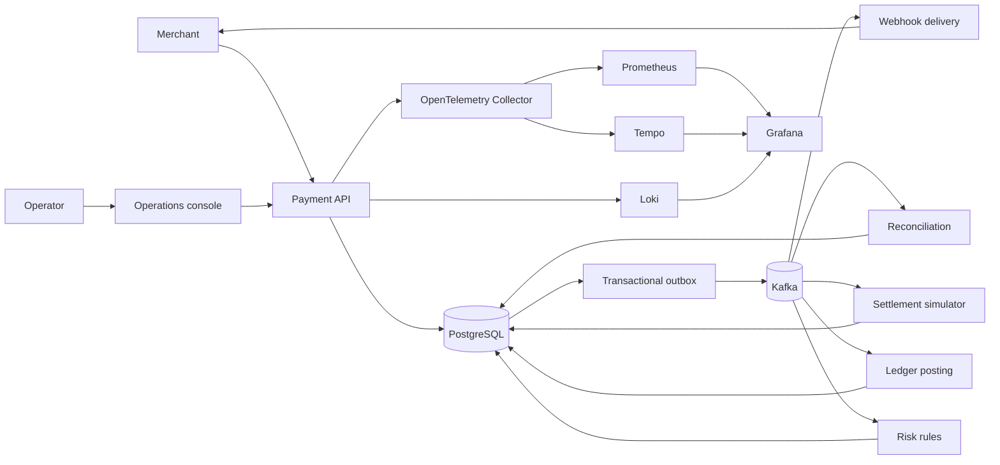
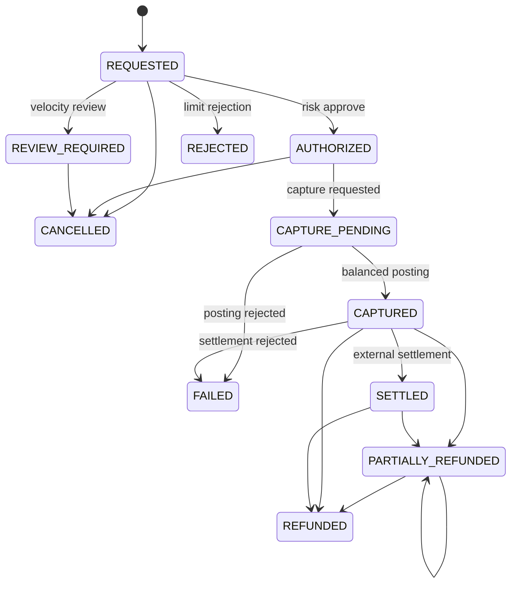

# PaymentOps architecture

## Context

The repository is a modular monolith: packages own separate domain models and
consumer idempotency names, while one deployable keeps local operation and
portfolio review practical. Changing `PAYMENTOPS_MESSAGING_MODE` from `local`
to `kafka` changes transport, not business handlers. Modules can be extracted
behind the existing event contracts if independent scaling becomes necessary.

## Financial consistency boundary

PostgreSQL is authoritative. A payment transition, immutable timeline entry,
audit evidence, and outgoing event are committed together. Capture and refund
consumers lock both accounts in ascending ID order, update materialized
balances, append one debit and one credit, and insert a posting record in one
transaction.

Three layers prevent duplicate effects:

1. `(consumer_name, event_id)` is unique in `processed_events`.
2. `(payment_id, operation_key)` and `source_event_id` are unique for payment
   postings.
3. Each side of a ledger event is unique by payment, event, account, and
   direction.

If processing commits and the service crashes before the Kafka offset commit,
replay reaches layer 1 and becomes a measured no-op.

## Payment state machine

Invalid transitions return `409` with a stable error code and correlation ID.
Repeated operations return the existing result after their idempotency
contract has completed.

## Data ownership

| Module | Owned tables |
|---|---|
| Payment API | `payments`, `payment_events`, `payment_refunds` |
| Event foundation | `outbox_events`, `processed_events` |
| Risk | `risk_decisions` |
| Ledger | `ledger_entries`, `payment_ledger_postings`, `accounts` |
| Settlement | `settlement_records` |
| Reconciliation | `reconciliation_exceptions`, `reconciliation_actions` |
| Notification | `webhook_deliveries` |
| Audit | `audit_events` |

Timeline, audit, and reconciliation-action tables have database triggers that
reject updates and deletes. Resolution changes exception state but appends a
new action, preserving original evidence.

## Security boundaries

The built-in local identity service is an OAuth2-style JWT issuer for
development. Access tokens contain scopes and roles; refresh tokens are stored
only as SHA-256 hashes and rotate on use. Production can replace the issuer
with an OIDC provider without changing controller authorization rules.

- merchants: `payments:read`, `payments:write`;
- operators: payment scopes plus `operations:read/write`, role `OPERATOR`;
- auditors: read scopes, role `AUDITOR`.

Public registration cannot choose a role. Payment tokens must match the
synthetic `tok_...` form. Webhook signing secrets and JWT keys are injected
through environment variables. Request bodies and authorization headers are
not logged.

## Observability

HTTP/database observations use Micrometer and OpenTelemetry. Event envelopes
carry correlation and causation IDs; the HTTP filter returns
`X-Correlation-ID` and adds it to structured logs. Custom metrics cover outbox
depth/failures, duplicate events, risk outcomes, ledger postings, settlement
records, reconciliation exceptions, webhook retries, and dead letters.

Grafana provisions Prometheus, Tempo, and Loki plus panels for throughput,
p95 latency, JVM heap, Kafka lag, retries/dead letters, and
settlement/reconciliation health.
